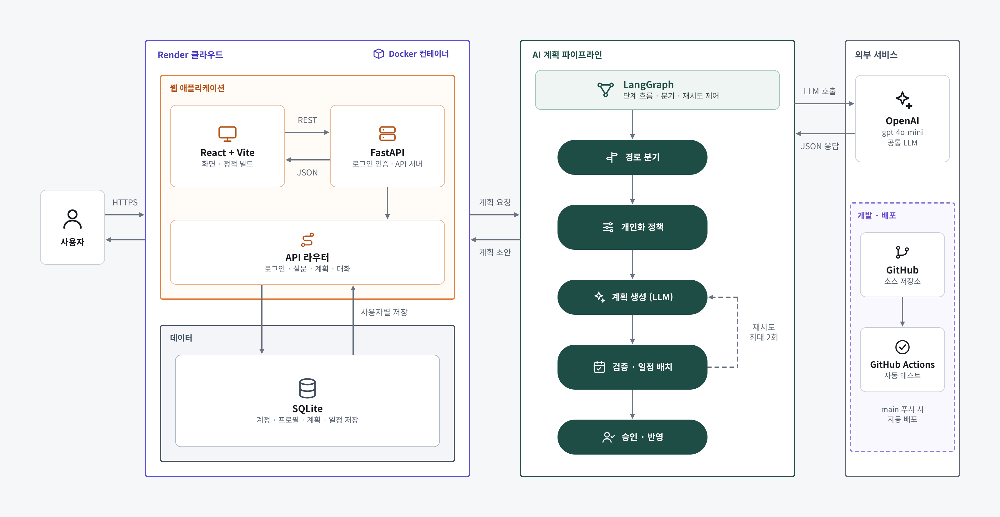

# PlannerKK

프로젝트 일정, 단계별 할 일, 캘린더, 기억을 한곳에서 관리하고 AI에게 프로젝트 계획 초안을 요청할 수 있는 플래너입니다.

**회원가입·로그인**을 지원합니다. 계정마다 프로젝트·할 일·캘린더·기억과 실행 프로필·가용 시간·주간 계획·완료 상태가 서버 SQLite DB에 따로 저장되고, AI 계획은 로그인한 사용자의 프로필을 기준으로 만들어집니다. 자세한 내용은 [로그인과 사용자별 데이터](#로그인과-사용자별-데이터)를 참고하세요. 기존 AI 계획은 **초안 생성 → 사용자 검토 → 단계별 할 일 반영** 순서로 동작합니다. 새 주간 플래너는 DB에 초안을 저장하고, 확정한 뒤 캘린더에 반영합니다.

**추가 기능과 간편 실행: [INTEGRATION.md](INTEGRATION.md)** — `python run_local.py`로 빌드된 화면과 API를 `http://127.0.0.1:8010`에서 함께 실행합니다.

## 시스템 구조



- **웹 애플리케이션**: React + Vite 화면과 FastAPI 서버가 Docker 이미지 하나로 Render에서 함께 실행됩니다. FastAPI는 로그인 세션을 확인하고, 화면이 쓰는 API와 빌드된 정적 파일을 제공합니다.
- **데이터**: 계정, 세션, 사용자별 설문·프로필·계획·일정을 SQLite 파일 하나에 저장합니다. 비밀번호는 해시로만 저장합니다.
- **AI 계획 파이프라인**: LangGraph가 단계 흐름을 제어합니다. 경로 분기 → 개인화 정책(설문으로 작업 길이·하루 작업량·시간대 결정) → 계획 생성(LLM) → 검증·일정 배치 → 사용자 승인 순서이며, 검증에 실패하면 최대 2회 다시 생성합니다.
- **외부 서비스**: OpenAI `gpt-4o-mini`를 계획 생성과 대화형 설문·플래너 대화에 씁니다. GitHub에 푸시하면 Actions가 테스트를 돌리고, `main`은 Render에 자동 배포됩니다.

## 기술 스택

- React + TypeScript + Vite
- FastAPI + Pydantic
- OpenAI `gpt-4o-mini` Structured Outputs
- Vitest + Testing Library / Python `unittest`

## 로컬 실행

### 1. 저장소와 의존성 준비

```bash
git clone https://github.com/hwc2000/plannerkk.git
cd plannerkk
npm install
python3 -m pip install -r requirements.txt
```

### 2. 서버 환경변수 설정

```bash
cp .env.example .env
```

`.env`의 `OPENAI_API_KEY`를 실제 키로 바꿉니다.

```dotenv
OPENAI_API_KEY=sk-...
OPENAI_PLAN_MODEL=gpt-4o-mini
FRONTEND_ORIGIN=http://localhost:5173
```

> `.env`는 Git에서 제외됩니다. OpenAI 키에 `VITE_` 접두사를 붙이거나 React 코드에 넣으면 브라우저에 노출되므로 반드시 FastAPI 서버에서만 사용합니다.

### 실행·배포 보안 범위

현재 AI API는 **개인 로컬 개발용**입니다. `npm run dev`와 문서의 Uvicorn 명령은 모두 `127.0.0.1`에만 바인딩되며, 요청 문자열·기존 할 일 수·AI 결과 항목 수에도 상한을 둡니다.

사용자 인증과 요청 제한은 아직 구현하지 않았습니다. 시연 URL은 `DEMO_PASSWORD`로 접속 비밀번호를 걸고 OpenAI 사용 한도를 설정한 **시연 전용**으로만 운영합니다([배포 안내](docs/deployment.md)). 공개·공유 서비스로 운영하기 전에는 최소한 다음 보호 장치를 추가해야 합니다.

- 사용자 인증·권한 확인
- 사용자/IP별 요청 속도 및 일일 사용량 제한
- 요청 본문 크기 제한과 사용량·비용 모니터링
- 운영 환경의 제한된 CORS 허용 출처 설정

### 3. FastAPI 실행 — 터미널 1

```bash
python3 -m uvicorn server.app.main:app --reload --host 127.0.0.1 --port 8000 --env-file .env
```

상태 확인: `http://127.0.0.1:8000/api/health`

### 4. React 실행 — 터미널 2

```bash
npm run dev
```

브라우저에서 `http://localhost:5173`을 엽니다. Vite가 `/api` 요청을 FastAPI의 `8000` 포트로 프록시합니다.

## AI 계획 사용법

1. 프로젝트를 먼저 생성하거나 기존 프로젝트를 선택합니다.
2. 사이드바에서 `오늘`을 엽니다.
3. 필요한 계획을 자연어로 입력하고 `계획 초안 만들기`를 누릅니다.
4. AI가 제안한 단계, 날짜, 예상 시간을 검토합니다.
5. 확정할 때만 `검토 후 단계별 할 일에 반영`을 누릅니다.

## 로그인과 사용자별 데이터

- 첫 화면에서 이메일·비밀번호(8자 이상)로 회원가입하거나 로그인합니다. 세션은 HttpOnly 쿠키(`replan_session`, 14일)로 유지되고, 사이드바 하단의 로그아웃 버튼으로 종료합니다.
- `/api/health`, `/api/auth/*`를 제외한 모든 `/api/*` 요청은 로그인이 필요합니다(없으면 401).
- 실행 프로필·주간 계획 등은 기존 `user_execution_state` 테이블에 사용자 ID별로, 프로젝트·할 일·캘린더·기억은 `user_workspace` 테이블에 저장됩니다. 다른 브라우저·기기에서 로그인해도 같은 데이터를 봅니다.
- 비밀번호는 PBKDF2-SHA256(39만 회, 솔트)으로 해시해 `users` 테이블에 저장하고, 세션 토큰은 SHA-256 해시만 저장합니다. 같은 이메일·IP에서 15분 동안 5번 틀리면 로그인이 잠시 막힙니다.
- **기존 데이터 이관:** 로그인 도입 전 DB(`execution_state`)의 실행 프로필은 **처음 가입한 계정**으로 옮겨집니다. 브라우저 localStorage에 남아 있던 프로젝트·일정·기억은 새 계정으로 처음 로그인할 때 가져올지 묻습니다.
- 혼자 로컬에서만 쓰려면 `.env`에 `REPLAN_AUTH=off`를 두면 예전처럼 로그인 없이 localStorage + 단일 사용자 DB로 동작합니다. HTTPS로 배포할 때는 `REPLAN_SECURE_COOKIES=1`을 설정합니다.

| API | 설명 |
| --- | --- |
| `POST /api/auth/signup` | `email`, `password`, `displayName` → 가입 후 바로 로그인 |
| `POST /api/auth/login` | `email`, `password` |
| `POST /api/auth/logout` | 세션 종료 |
| `GET /api/auth/me` | 현재 사용자 |
| `GET /api/auth/config` | 로그인 사용 여부 |
| `GET/PUT /api/workspace` | 내 프로젝트·할 일·캘린더·기억 |

## 검사 명령어

| 명령어 | 설명 |
| --- | --- |
| `npm run dev` | React 개발 서버 실행 |
| `npm test` | 프론트엔드 테스트 실행 |
| `npm run build` | TypeScript 검사 및 프로덕션 빌드 |
| `npm run preview` | 빌드 결과 미리보기 |
| `python3 -m unittest discover -s server/tests -v` | FastAPI·OpenAI 계획 로직 테스트 |

## 현재 상태

구현됨:

- 브라우저에 저장되는 프로젝트·할 일·캘린더·기억 관리
- AI 계획 초안 생성 → 사용자 확인 → 할 일 반영
- 실행 프로필 온보딩, 규칙 기반/LLM 분석, 수정·확정·초기화·JSON 내보내기
- 요일별 가용 시간, 구체적인 주간 시간 배치, 체크리스트 전환 및 완료 상태 동기화
- SQLite 저장 및 확정 계획의 기존 캘린더 연동

아직 안 됨:

- Supabase(현재는 로컬 SQLite)
- 달성률·마감일·위험도 API
- LangGraph 채팅·전체 재조정·AI 기억 승인

## 팀 작업 기준

지금 단계에서는 Supabase를 사용하지 않습니다. 각자 만든 기능을 합칠 수 있도록 **localStorage 키와 객체 필드 이름을 똑같이 사용합니다.**

### 문서에서 쓰는 용어

`스키마`라는 말이 여러 뜻으로 섞이지 않도록 아래처럼 구분합니다.

| 용어 | 뜻 | 현재 기준 |
| --- | --- | --- |
| **공용 데이터 계약** | 팀 기능 사이에 주고받는 객체의 필드와 값 | 프론트는 `src/shared/types.ts`, API는 Pydantic 요청·응답 모델과 설계 문서 |
| **공용 관계형 DB 스키마** | Supabase의 테이블·열·외래 키 관계 | 아직 없음. Supabase 도입 때 별도로 설계 |
| **로컬 SQLite 구조** | 로컬 DB의 실제 테이블 구조 | `execution_state(id, document)` 한 테이블이며, `document` 열에 JSON을 저장 |
| **실행 저장 상태** | 위 JSON 안에 저장하는 프로필·계획·기록 묶음 | `server/app/execution_store.py`의 `empty_state()` |
| **PlannerState** | LangGraph를 한 번 실행하는 동안 노드 사이에서 전달하는 임시 상태 | `server/app/adaptive/state.py`. DB 구조가 아니며 실행이 끝나면 자체 저장되지 않음 |
| **LLM 출력 스키마** | AI 응답 형식을 검사하는 JSON Schema | 각 LLM 생성기에서만 사용하며 DB 구조와 무관 |

팀원 C가 소유하는 스키마는 그래프 내부의 **`PlannerState`**입니다. A의 프로필과 B의 실행 기록은 C가 확정하는 스키마가 아니며, 현재는 그래프를 시험하기 위한 임시 converter와 로컬 어댑터만 둡니다. A·B의 공용 계약이 올라오면 경계에서 맞춥니다.

팀원 C의 State와 A·B 연동 경계는 [PlannerState와 연동 경계](docs/planning/adaptive-planner-state-contract.md)에 정리했습니다.

### localStorage 키

| 저장 데이터 | 키 | 타입 |
| --- | --- | --- |
| 프로젝트 | `replan-projects-v1` | `Project[]` |
| 단계별 할 일 | `replan-milestones-v1` | `Milestone[]` |
| 캘린더 일정 | `replan-events-v1` | `CalendarEvent[]` |
| 기억 | `replan-memories-v1` | `Memory[]` |

### 객체 필드 이름

- `Project`: `id`, `title`, `goal`, `startDate`, `dueDate`, `priority`, `status`
- `Milestone`: `id`, `projectId`, `title`, `startDate`, `dueDate`, `estimatedHours`, `status`
- `CalendarEvent`: `id`, `title`, `date`, `startTime`, `endTime`, `projectId`, `isFixed`
- `Memory`: `id`, `content`, `category`, `source`, `createdAt`

값도 아래 문자열로 통일합니다.

- `priority`: `high | medium | low`
- 프로젝트 `status`: `active | completed | paused`
- 할 일 `status`: `todo | in_progress | done | deferred`
- `category`: `availability | preference | priority | context`
- `source`: `user | ai_approved`
- `CalendarEvent.projectId`만 선택값이며, 나머지 필드는 필수입니다.

꼭 지킬 것:

1. 위 이름을 그대로 사용하고 비슷한 이름의 키나 필드를 새로 만들지 않습니다.
2. 필드 이름은 `camelCase`를 사용합니다. 예: `startDate`, `projectId`.
3. 날짜는 `YYYY-MM-DD`, 시간은 `HH:mm`, `id`는 문자열로 저장합니다.
4. 프론트 공용 데이터 계약의 기준은 `src/shared/types.ts`입니다. 바꿔야 하면 먼저 팀에 알리고 이 파일부터 함께 수정합니다.
5. 작업 전 최신 `main`에서 새 브랜치를 만들고, 작업 후 테스트와 빌드를 확인해 Pull Request를 올립니다.

> 현재 데이터는 각자의 브라우저에 따로 저장됩니다. 브라우저끼리 데이터를 공유하는 기능은 아직 없습니다.
